<p align="center">
  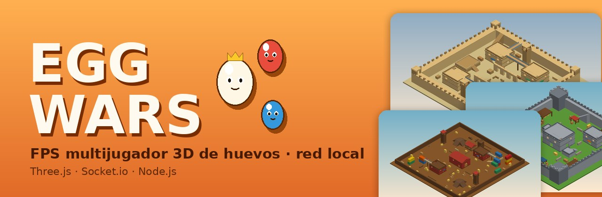
</p>

<h1 align="center">🥚 EGG WARS</h1>

<p align="center">
  <b>Shooter 3D multijugador de huevos para jugar en red local.</b><br>
  Inspirado en Shell Shockers · hecho con Three.js, Socket.io y Node.js
</p>

<p align="center">
  
  
  
  
  
</p>

---

## 📋 Índice
- [Arrancar en 1 minuto](#-arrancar-en-1-minuto)
- [Los 10 mapas](#️-los-10-mapas)
- [Armas](#-armas)
- [Modos de juego](#-modos-de-juego)
- [Controles](#️-controles)
- [Salas, admin y taller del huevo](#-salas-admin-y-taller-del-huevo)
- [Rendimiento y calidad gráfica](#-rendimiento-y-calidad-gráfica)
- [Modo producción (código protegido)](#-modo-producción-código-protegido)
- [Estructura del proyecto](#-estructura-del-proyecto)
- [Pruebas](#-pruebas)
- [Crear tu propio mapa](#-crear-tu-propio-mapa)

---

## 🚀 Arrancar en 1 minuto

```bash
npm install
npm start
```

Abre **http://localhost:3000**. Desde otros ordenadores de la misma red, usa la IP que muestra la consola del servidor (por ejemplo `http://192.168.1.20:3000`).

> ℹ️ Three.js se descarga de unpkg.com, así que los equipos necesitan Internet la primera vez que cargan el juego.

---

## 🗺️ Los 10 mapas

Todos los mapas son de diseño propio. Tienen **varios niveles** (edificios de 2 pisos, puentes, torres y terrazas), **coberturas** repartidas por el suelo y un **paisaje alrededor**: colinas, bosque, ciudad, mar o la superficie lunar. Así no se nota dónde acaba el mapa.

| | |
|:---:|:---:|
| 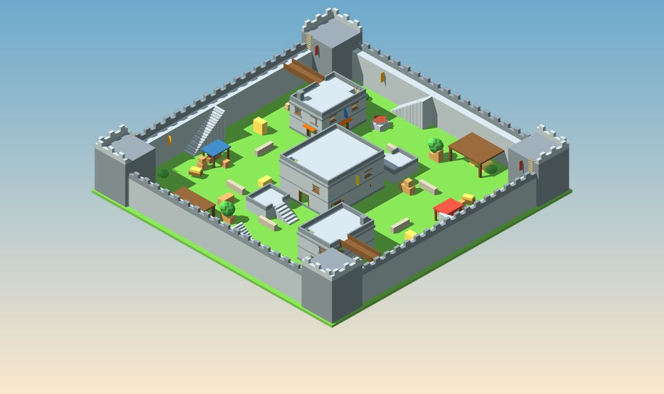<br>**🏰 Castle** · mediano · 12 jugadores<br><sub>Murallas con paseo de ronda y almenas, cuatro torres, torreón de dos pisos, barracones con puentes a la muralla y mercadillo en el patio.</sub> | 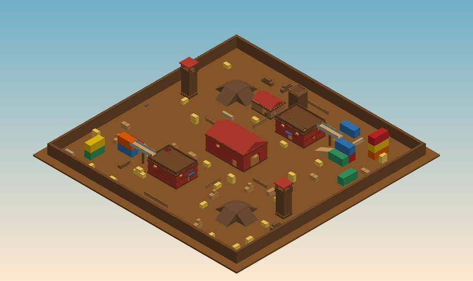<br>**🚜 Dirt** · grande · 18 jugadores<br><sub>Granero con pajar y tejado transitable, torres de contenedores, establos de dos pisos con puentes, silos, torres de vigía y lomas.</sub> |
| 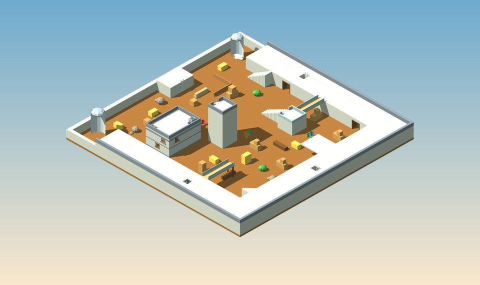<br>**🐄 Feedlot** · mediano · 18 jugadores<br><sub>Túneles que rodean dos tercios del mapa con techo transitable, torre central, voladizo, oficina de dos pisos y pasarelas.</sub> | 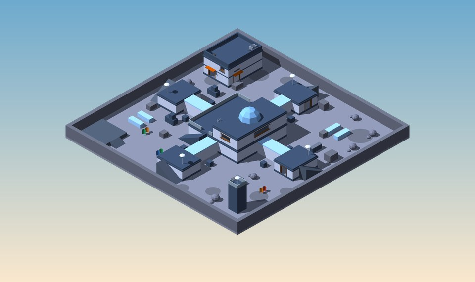<br>**🌙 Moonbase** · mediano · 18 jugadores<br><sub>Base lunar con baja gravedad: núcleo con pasillos en anillo, sala de control, módulos, laboratorio y torre de antenas.</sub> |
| 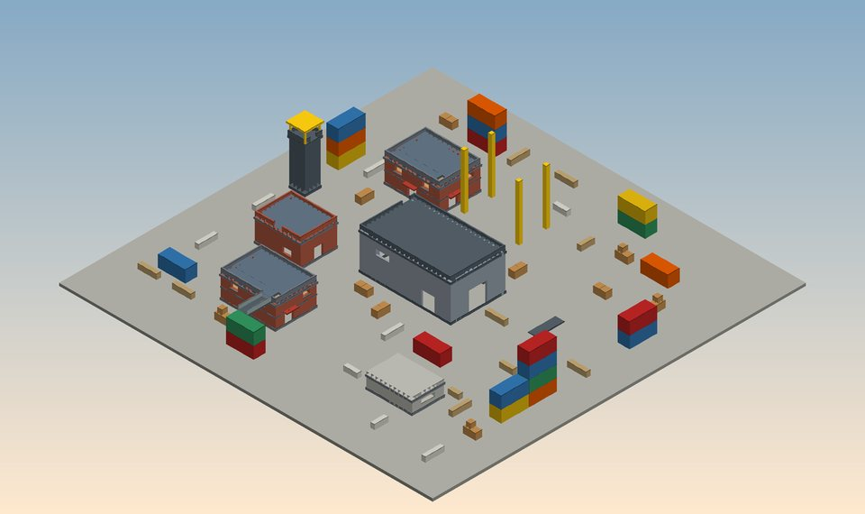<br>**⚓ Shipyard** · grande · 18 jugadores<br><sub>Puerto rodeado de mar: gran almacén, oficinas de ladrillo, torres de contenedores de hasta 4 alturas, grúa, tanques y búnker.</sub> | 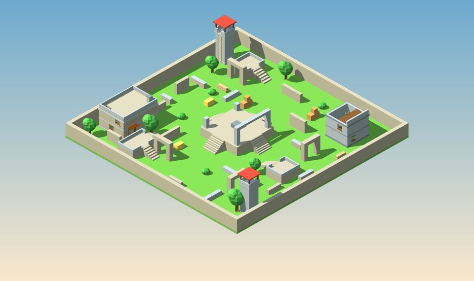<br>**🏛️ Ruins** · mediano · 18 jugadores<br><sub>Ruinas cubiertas de hierba: templo elevado, arcos, columnas caídas, casa en ruinas de dos pisos, terrazas y torres.</sub> |
| 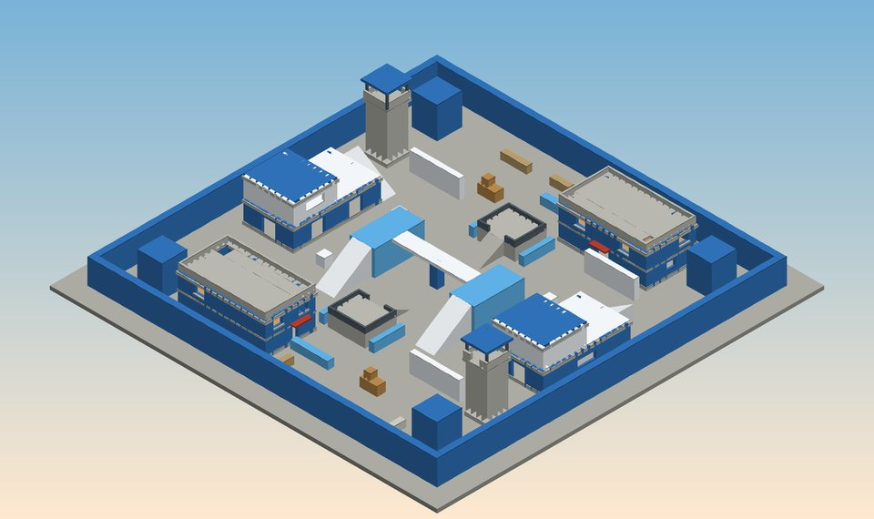<br>**🔷 Blue** · mediano · 18 jugadores<br><sub>Mapa simétrico de bloques azules: bases de dos plantas, puente de cristal, oficinas, torres y terrazas centrales.</sub> | 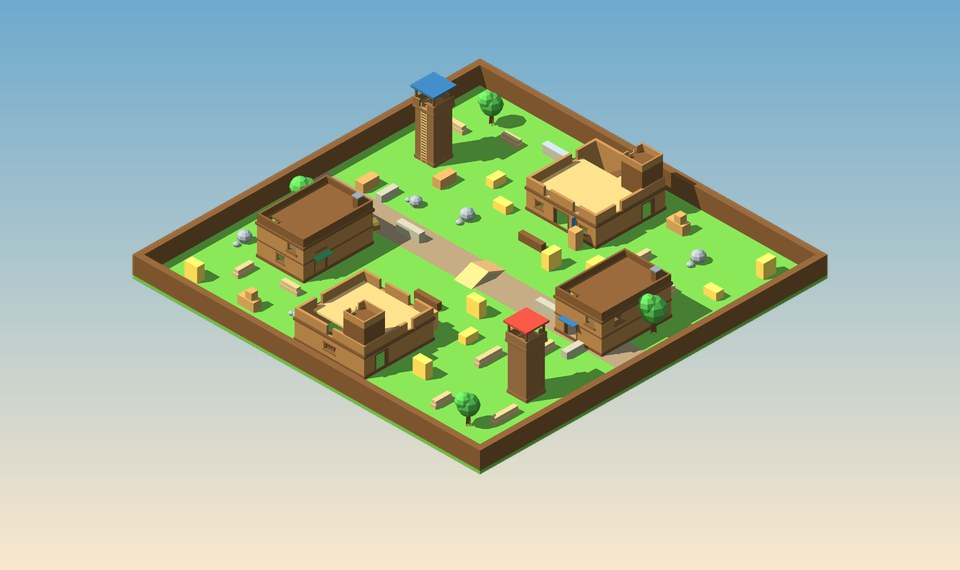<br>**🪵 Fort Flip** · mediano · 18 jugadores<br><sub>Dos fuertes de madera con almenas y atalaya frente a frente, separados por un arroyo seco con puente. También hay cuarteles y torres.</sub> |
| 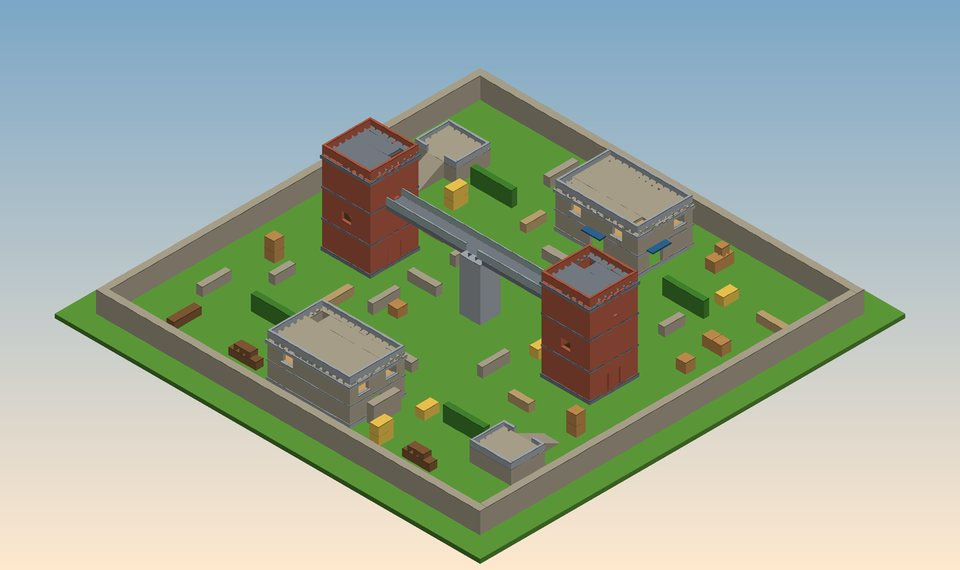<br>**🗼 Two Towers** · mediano · 18 jugadores<br><sub>Dos torres de tres plantas con escaleras interiores, unidas por un puente a 8 m de altura, y puestos de guardia de dos pisos.</sub> | 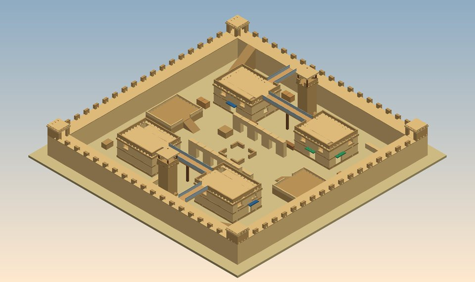<br>**🕌 Medina** · mediano · 18 jugadores · *nuevo*<br><sub>Ciudad de arenisca: murallas con paseo y casetas, casas de dos pisos unidas por puentes, minaretes, arcadas y plaza con fuente.</sub> |

<sub>Las imágenes se generan directamente a partir de la geometría real de cada mapa (vista isométrica).</sub>

---

## 🔫 Armas

Eliges un **arma principal** al reaparecer. Todos llevan además la **pistola Cluck 9mm**, el **golpe cuerpo a cuerpo** y **granadas**.

| Arma | Daño por bala | Estilo |
|---|:---:|---|
| **EggK-47** | 23 | Automático clásico de medio alcance: cadencia alta y nunca se encasquilla. |
| **Scrambler** | 16 × perdigón | Escopeta: dos disparos devastadores a quemarropa. Recarga rápida. |
| **Free Ranger** | 52 | Semiautomático con mira: dos disparos al cuerpo o uno a la cabeza. |
| **RPEGG** | cohete | Un impacto directo revienta a cualquiera y salpica mucho daño alrededor. ¡Cuidado con tu propio cohete! |
| **Whipper** | 15 | Cargador enorme y cadencia altísima para la corta distancia. |
| **Crackshot** | 90 | Francotirador de cerrojo: un disparo a la cabeza revienta cualquier huevo. |
| **Tri-Hard** | 26 | Ráfagas de tres balas muy precisas, para media distancia. |
| **Cluck 9mm** | 24 | Pistola de apoyo: rápida de sacar y precisa. |

El servidor decide todos los impactos: comprueba la línea de visión, la cadencia y el daño, así que no se puede hacer trampa desde el navegador.

---

## 🎮 Modos de juego

| Modo | Objetivo |
|---|---|
| **Todos contra todos** | Gana quien llegue antes al número de bajas. |
| **Duelo por equipos** | Rojos contra azules. Puedes cambiarte de equipo desde el menú (Esc). |
| **King of the Coop** | Conquista el gallinero y mantenlo para sumar puntos. El gallinero cambia de sitio. |
| **Capture the Spatula** | Roba la espátula y llévala a tu base. |

---

## ⌨️ Controles

| Acción | Tecla |
|---|---|
| Moverse | **W A S D** |
| Saltar | **Espacio** |
| Disparar | **Clic izquierdo** |
| Apuntar | **Clic derecho** o **Shift** |
| Recargar | **R** |
| Pistola ⇄ principal | **E** (o **1** / **2**) |
| Granada | **Q** (mantén pulsado para lanzarla más lejos) |
| Golpe | **F** |
| Inspeccionar arma | **G** |
| Menú / ajustes | **Esc** |

Puedes cambiar todas las teclas en **Ajustes**.

---

## 🧑‍🤝‍🧑 Salas, admin y taller del huevo

- **Crear partida**: eliges mapa (con vista previa 3D), modo, número de jugadores, meta de bajas, tiempo y si la sala es privada (con un código de 4 letras).
- **Admin de la sala**: es quien la crea; si se va, pasa a ser el que más tiempo lleve. Puede pausar, reanudar, reiniciar o terminar la ronda, cambiar mapa, modo, meta o tiempo, mover jugadores de equipo y expulsar (Esc en partida).
- **Cuentas de usuario**: con contraseña cifrada, amigos, invitaciones a sala y retos diarios.
- **Taller del huevo**: color, patrón, sombrero, gafas y extras, presets y **pintura directa sobre el huevo 3D** (pincel, spray, goma, simetría y deshacer).

---

## ⚡ Rendimiento y calidad gráfica

El juego está pensado para ir fluido también en **gráficas integradas** (Intel HD y similares):

- **Calidad automática**: detecta tu gráfica al arrancar y, si en partida baja de 42 FPS durante unos segundos, reduce la calidad sola. En calidad baja puede reducir también la resolución interna.
- **Mapas en pocas llamadas de dibujo**: toda la geometría y la decoración estática se fusionan por material, de unas 400 llamadas a unas 100 en los mapas grandes.
- **Sombras inteligentes**: el mapa de sombras sigue al jugador y en calidad media/baja se recalcula cada 2 fotogramas. Solo proyecta sombra el cuerpo de los huevos.
- **Detalle por distancia**: a lo lejos se ocultan accesorios que no se distinguen; agujeros de bala instanciados (2 llamadas para todos).
- **Sin tirones**: los shaders del mapa se compilan al cargarlo, no en mitad de la partida.
- **Red suave**: los demás jugadores se interpolan y, si un paquete llega tarde, se extrapola su movimiento un instante.

| Calidad | Resolución interna | Sombras | Extras |
|---|---|---|---|
| **Alta** | hasta 1,5× | suaves, cada fotograma, 2048 px | hierba, partículas, luces de disparo |
| **Media** | nativa | cada 2 fotogramas, 1024 px | hierba, partículas |
| **Baja** | nativa (o menos si hace falta) | sin sombras | sin decoración pequeña |

Se cambia en **Ajustes → Calidad**. Activa **Mostrar FPS** para ver cómo va.

---

## 🔒 Modo producción (código protegido)

```bash
npm install          # instala terser (solo hace falta una vez)
npm run build        # genera dist/ con un único JS minificado y ofuscado
npm run start:prod   # el servidor sirve SOLO dist/
```

- En producción nadie puede descargar los archivos fuente (`js/main.js`, `shared/…`), solo el paquete ofuscado.
- `server/`, `data/` (cuentas y contraseñas cifradas), `tests/` y `package.json` nunca se sirven por la red.
- Todo juego web tiene que mandar su código de cliente al navegador para funcionar. Ofuscarlo lo hace muy difícil de leer, pero no imposible. Lo importante (daño, disparos, admin y cuentas) se decide en el servidor, que nadie más ve.
- Para que **solo tú** puedas modificar el código, guárdalo en un repositorio **privado** de GitHub y no compartas la carpeta.

---

## 📁 Estructura del proyecto

```
shell/
├── server/
│   ├── server.js        # HTTP, lobby, salas, cuentas, seguridad
│   └── gameRoom.js      # rondas, modos, admin, validación de disparos
├── shared/              # código común cliente + servidor
│   ├── mapbuilder.js    # primitivas (cajas, rampas, casas, puentes, torres…) y materiales
│   ├── mapdefs.js       # los 10 mapas + cobertura automática
│   ├── physics.js       # físicas del jugador, escaleras, raycast, granadas
│   ├── gamedata.js      # armas, modos y reglas
│   └── cosmetics.js     # personalización del huevo
├── public/
│   ├── index.html · style.css
│   └── js/
│       ├── main.js      # cliente del juego (render, HUD, red, armas)
│       ├── maps.js      # render de mapas, paisaje, cielo, vistas previas 3D
│       └── eggmodel.js  # modelo 3D del huevo y accesorios
├── tests/               # validador de mapas, prueba de jugabilidad y del servidor
├── tools/build.js       # compilación de producción
└── docs/img/            # imágenes de este README
```

---

## ✅ Pruebas

```bash
npm test
```

| Prueba | Qué comprueba |
|---|---|
| `validate-maps.js` | Spawns libres y estables, escaleras y rampas bien colocadas, edificios que no se solapan. |
| `playtest.js` | Un **jugador simulado** con las físicas reales sube todas las escaleras de mano, escalinatas y rampas, sale andando de cada spawn y busca rincones donde quedarse atrapado. |
| `fuzz-physics.js` | Movimientos aleatorios por todos los mapas para comprobar que nadie atraviesa paredes ni se sale del mapa. |
| `server-test.js` | Salas, cuentas, disparos (línea de visión, daño), cohetes, granadas, modos y admin. |

---

## 🧱 Crear tu propio mapa

Define un objeto en `shared/mapdefs.js` con una función `build(b)` y añádelo a `LIST`:

```js
build(b) {
  b.perimeter(30, 3, 'stone', 1);                       // muro exterior
  b.house2(-10, -12, 12, 9, 'brick', { h1: 2.6 });      // casa de 2 pisos con azotea
  b.bridge(-4, -12, 8, -12, 5.5, 2.2, 'plank');         // puente con barandillas
  b.tower(18, 18, 8, 3.2, 'stoneDark', 'w', { roof: 'roofRed' });  // torre de vigía
  b.platform(0, 10, 6, 5, 2, 'stone', ['s'], { stairs: true });    // terraza elevada
}
```

Primitivas disponibles: `box`, `aabb`, `slab`, `ramp`, `stairs`, `ladder`, `room`, `wallSeg`, `ring`, `container`, `crate`, `hay`, `hill`, `pillar`, `tree`, `gable`, `house2`, `bridge`, `tower`, `platform` y `decoAt`. La **cobertura del suelo se añade sola**; se ajusta con `coverDensity` o se desactiva con `cover: false`.

Después ejecuta `npm test`: el validador y la prueba de jugabilidad te dirán si algún spawn, escalera o rampa ha quedado mal.

---

<p align="center"><sub>Hecho por Pablo Campayo Viñes</sub></p>
