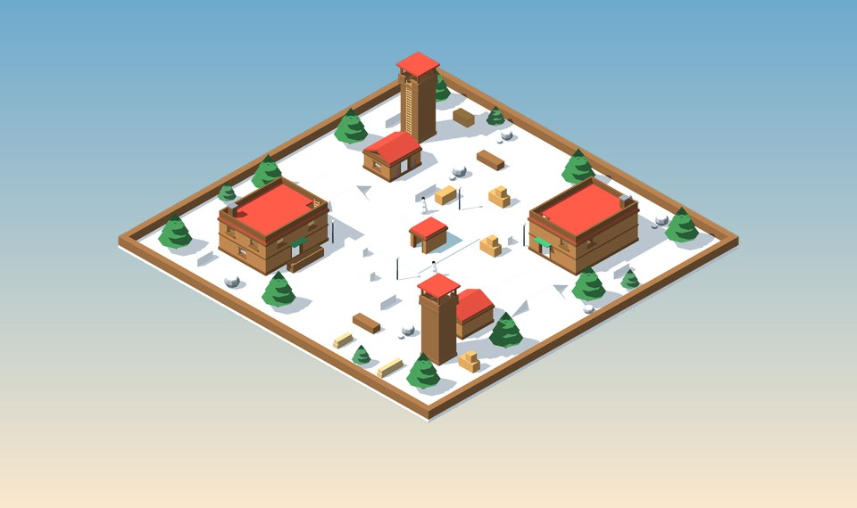
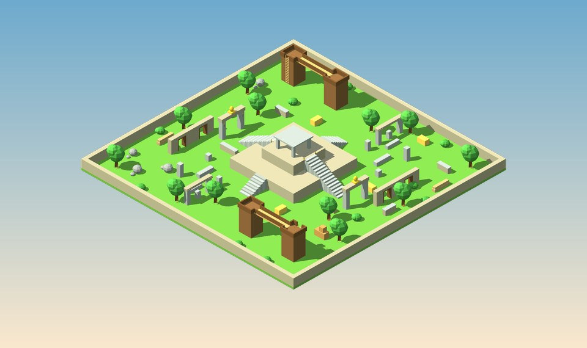
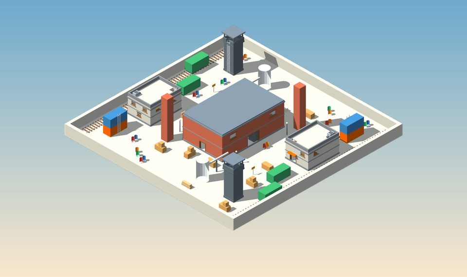
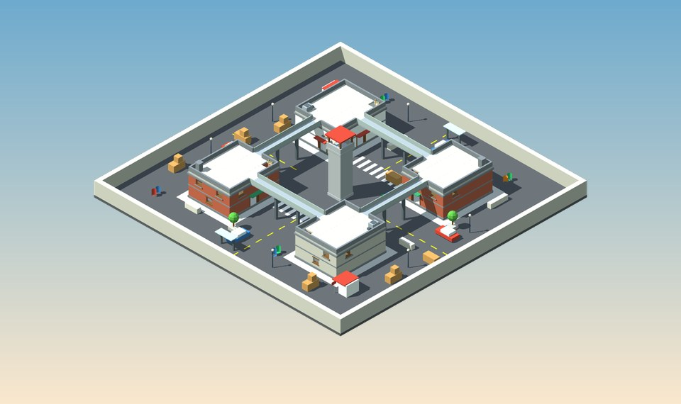
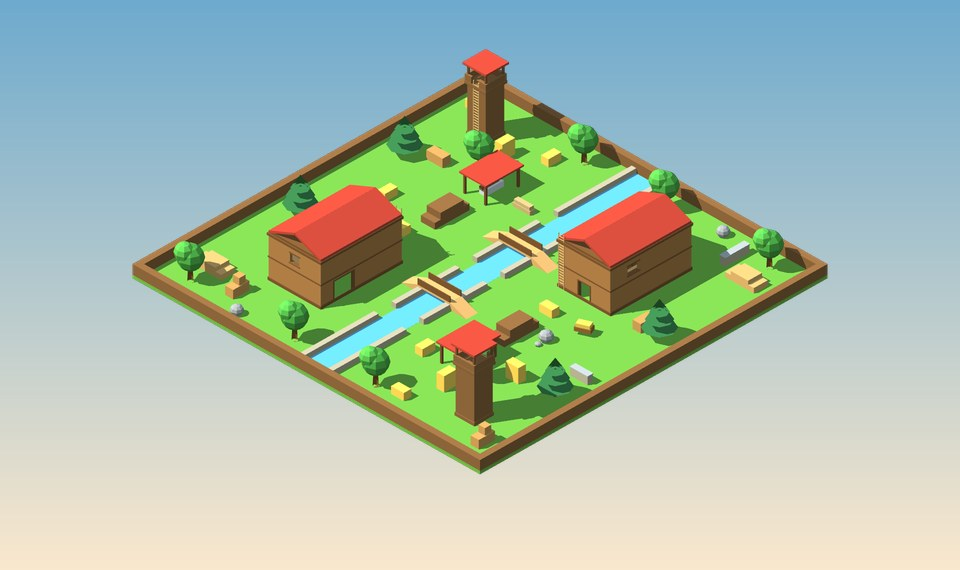

<p align="center">
  
</p>

<h1 align="center">🥚 EGG WARS</h1>

<p align="center">
  <b>Shooter 3D multijugador de huevos para jugar en red local.</b><br>
  Inspirado en Shell Shockers · hecho con Three.js, Socket.io y Node.js
</p>

<p align="center">
  
  
  
  
  
  
  
  
</p>

---

## 📋 Índice
- [Arrancar en 1 minuto](#-arrancar-en-1-minuto)
- [Los 16 mapas](#️-los-16-mapas)
- [Armas y granadas](#-armas-y-granadas)
- [Modos de juego](#-modos-de-juego)
- [🔪 Huevo Impostor (modo nuevo)](#-huevo-impostor-modo-nuevo)
- [Controles](#️-controles)
- [Salas, admin y taller del huevo](#-salas-admin-y-taller-del-huevo)
- [🤖 Bots](#-bots)
- [🌐 Jugar sin servidor (GitHub Pages)](#-jugar-sin-servidor-github-pages)
- [Anti-trampas](#️-anti-trampas)
- [Rendimiento y calidad gráfica](#-rendimiento-y-calidad-gráfica)
- [Modo producción (código protegido)](#-modo-producción-código-protegido)
- [Estructura del proyecto](#-estructura-del-proyecto)
- [Pruebas](#-pruebas)
- [Crear tu propio mapa](#-crear-tu-propio-mapa)

---

## 🚀 Arrancar en 1 minuto

```bash
npm install
npm start
```

Abre **http://localhost:3000**. Desde otros ordenadores de la misma red, usa la IP que muestra la consola del servidor (por ejemplo `http://192.168.1.20:3000`).

> ℹ️ Three.js se descarga de unpkg.com, así que los equipos necesitan Internet la primera vez que cargan el juego.

---

## 🗺️ Los 16 mapas

Todos los mapas son de diseño propio. Tienen **varios niveles** (edificios de 2 pisos, puentes, torres y terrazas), **coberturas** repartidas por el suelo (cajas, sacos, muretes, barriles y pacas) y un **paisaje alrededor**: colinas, bosque, ciudad, mar o la superficie lunar. Así no se nota dónde acaba el mapa. Las puertas y ventanas tienen marco, y las escaleras tienen peldaños marcados y barandillas en los lados abiertos.

**Novedades de la 6.2:** **bots** (también en la versión web sin servidor), menú de crear partida rediseñado, calidad **Ultra** y más contenido en los mapas que estaban más vacíos (cabaña de esquí en Nevada, oficinas, vía de tren y depósito en Fábrica, cobertizo de la sierra y pasarelas sobre el arroyo en Aserradero, puerta del ídolo y columnata en Templo, marcas viales, jardineras y quiosco en Centro), chimeneas o máquinas de aire acondicionado en las azoteas, rocas como cobertura natural, sacos en dos hileras y muretes con remate. Las barandillas de los puentes ahora se ven caladas (como funcionan: las balas las atraviesan).

| | |
|:---:|:---:|
| <br>**🏰 Castle** · mediano · 12 jugadores<br><sub>Murallas con paseo de ronda y almenas, cuatro torres, torreón de dos pisos, barracones con puentes a la muralla y mercadillo en el patio.</sub> | <br>**🚜 Dirt** · grande · 18 jugadores<br><sub>Granero con pajar y tejado transitable, torres de contenedores, establos de dos pisos con puentes, silos, torres de vigía y lomas.</sub> |
| <br>**🐄 Feedlot** · mediano · 18 jugadores<br><sub>Túneles que rodean dos tercios del mapa con techo transitable, torre central, voladizo, oficina de dos pisos y pasarelas.</sub> | <br>**🌙 Moonbase** · mediano · 18 jugadores<br><sub>Base lunar con baja gravedad: núcleo con pasillos en anillo, sala de control, módulos, laboratorio y torre de antenas.</sub> |
| <br>**⚓ Shipyard** · grande · 18 jugadores<br><sub>Puerto rodeado de mar: gran almacén, oficinas de ladrillo, torres de contenedores de hasta 4 alturas, grúa, tanques y búnker.</sub> | <br>**🏛️ Ruins** · mediano · 18 jugadores<br><sub>Ruinas cubiertas de hierba: templo elevado, arcos, columnas caídas, casa en ruinas de dos pisos, terrazas y torres.</sub> |
| <br>**🔷 Blue** · mediano · 18 jugadores<br><sub>Mapa simétrico de bloques azules: bases de dos plantas, puente de cristal, oficinas, torres y terrazas centrales.</sub> | <br>**🪵 Fort Flip** · mediano · 18 jugadores<br><sub>Dos fuertes de madera con almenas y atalaya frente a frente, separados por un arroyo seco con puente. También hay cuarteles y torres.</sub> |
| <br>**🗼 Two Towers** · mediano · 18 jugadores<br><sub>Dos torres de tres plantas con escaleras interiores, unidas por un puente a 8 m de altura, puestos de guardia de dos pisos y rocas en los flancos.</sub> | <br>**🕌 Medina** · mediano · 18 jugadores<br><sub>Ciudad de arenisca: murallas con paseo y casetas, casas de dos pisos unidas por puentes, minaretes, arcadas y plaza con fuente.</sub> |
| <br>**🏔️ Nevada** · mediano · 18 jugadores · *nuevo*<br><sub>Aldea alpina: chalés de dos pisos, estanque helado con caseta de pesca, cabañas de alquiler de esquís con tejado transitable, torres del telesilla, rocas nevadas, muñecos de nieve y bosque de pinos.</sub> | <br>**🛕 Templo** · mediano · 18 jugadores · *nuevo*<br><sub>Pirámide escalonada en la selva con santuario en la cima, puertas de piedra con el ídolo del huevo dorado, columnatas en ruinas, arcos y torres de troncos unidas por puentes.</sub> |
| <br>**🏭 Fábrica** · mediano · 18 jugadores · *nuevo*<br><sub>Gran nave con pasarelas interiores a 4 m, oficinas de dos plantas con azotea, vía de tren con vagones, depósitos con tubería, chimeneas, contenedores y torre de agua para francotiradores.</sub> | <br>**🏙️ Centro** · mediano · 18 jugadores · *nuevo*<br><sub>Cuatro edificios con las azoteas unidas por puentes sobre las calles, pasos de cebra y líneas pintadas, coches, jardineras, quioscos, marquesina y torre del reloj en el cruce.</sub> |
| <br>**🪓 Aserradero** · mediano · 18 jugadores · *nuevo*<br><sub>Serrería con altillo y tejado a dos aguas transitable, cobertizos con la sierra, arroyo con vados y pasarelas de tablones, pilas de troncos y torres de vigía en el bosque.</sub> | **🥚 ÑEMANAVE** · grande · 12 jugadores · *nuevo*<br><sub>La nave de Huevo Impostor, ahora para los tiros: combate en interiores por La Yema, 4 pasillos y 12 salas (hornos, caldera, granero, nidos…) con toda su decoración. Funciona en los 4 modos.</sub> |

<sub>Las imágenes se generan directamente a partir de la geometría real de cada mapa (vista isométrica).</sub>

---

## 🔫 Armas y granadas

Eliges un **arma principal** al reaparecer. Todos llevan además la **pistola Cluck 9mm**, el **golpe cuerpo a cuerpo** y **granadas**.

| Arma | Daño por bala | Estilo |
|---|:---:|---|
| **EggK-47** | 23 | Automático clásico de medio alcance: cadencia alta y nunca se encasquilla. |
| **Scrambler** | 16 × perdigón | Escopeta: dos disparos devastadores a quemarropa. Recarga rápida. |
| **Free Ranger** | 52 | Semiautomático con mira: dos disparos al cuerpo o uno a la cabeza. |
| **RPEGG** | 110 directo · hasta 110 de explosión | El impacto directo elimina siempre (aunque el enemigo se mueva mientras vuela el cohete). La explosión (3,6 m) sólo mata muy cerca del centro (~1 m): a 2 m quita unos 75. Cohete más lento (36 m/s), 1,1 s entre disparos y 3 s de recarga. ¡Cuidado con tu propio cohete! |
| **Whipper** | 15 | Cargador enorme y cadencia altísima para la corta distancia. |
| **Crackshot** | 90 | Francotirador de cerrojo: un disparo a la cabeza revienta cualquier huevo. |
| **Tri-Hard** | 26 | Ráfagas de tres balas muy precisas, para media distancia. |
| **Cluck 9mm** | 24 | Pistola de apoyo: rápida de sacar y precisa. |

### 💣 Granadas en el suelo
Las granadas **no se regeneran solas**. Están repartidas por el suelo de cada mapa (de 6 a 8, lejos de los spawns) y se recogen **pasando por encima**, de una en una, hasta un **máximo de 3**. Cada una vuelve a aparecer en su sitio 14 segundos después de recogerla. Al reaparecer empiezas sin granadas, así que hay que ir a por ellas.

- **Lanzar:** mantén **Q** para cargar (verás la granada en la mano echándose hacia atrás) y suelta para lanzarla. Cuanto más cargues, más lejos llega.
- En el aire deja una **estela de humo** y una **luz roja que parpadea cada vez más rápido** antes de explotar.
- La explosión tiene onda expansiva, trozos que salen volando, una **columna de humo** y una **marca quemada** en el suelo.

### 💥 Animación de muerte
Cuando un huevo cae, se aplasta un instante y **estalla**: cáscaras de su color por fuera y blancas por dentro, una onda blanca, y la **yema** que cae, rebota y se aplasta en el suelo.

---

## 🎮 Modos de juego

| Modo | Objetivo |
|---|---|
| **Todos contra todos** | Gana quien llegue antes al número de bajas. |
| **Duelo por equipos** | Rojos contra azules. Puedes cambiarte de equipo desde el menú (Esc). |
| **King of the Coop** | Conquista el gallinero y mantenlo para sumar puntos. El gallinero cambia de sitio. |
| **Capture the Spatula** | Roba la espátula y llévala a tu base. |
| **🔪 Huevo Impostor** | Modo aparte de deducción social en una nave espacial (ver abajo). |

---

## 🔪 Huevo Impostor (modo nuevo)

Modo **independiente** de deducción social en **primera persona**: todos sois huevos a bordo de la **ÑEMANAVE** (mapa propio y original). No comparte nada con los otros modos: tiene su propia página (`/impostor.html`), su propia sala en el servidor (`server/impostorRoom.js`) y no aparece en la lista de salas ni en la partida rápida del FPS. Se entra con el botón **🔪 Huevo Impostor** del menú principal (con la misma cuenta).

### Cómo se juega

- **4–10 huevos** por nave, cada uno de un color para reconoceros en las reuniones.
- **Impostores configurables (1–3)**. En automático: 1 con 4–6 jugadores y 2 con 7–10 (se pueden poner hasta 3).
- **Tripulantes**: completad las tareas (la barra de la nave es común) o expulsad a todos los impostores.
- **Impostores**: cascad a la tripulación (con espera entre muertes), viajad por los **conductos**, **apagad las luces**, **calentad la caldera** o **cerrad las puertas** de una sala. Sus tareas son falsas: se «falsifican» con un minijuego propio.
- **Cuerpos e informes**: quien encuentra un huevo roto puede informar. Hay **1 reunión de emergencia** por jugador (la sartén con el huevo frito de La Yema: la yema es el botón).
- **Reuniones**: debate con **chat** y **votación** (o saltar voto). Empate = nadie sale. Opcionalmente se confirma si el expulsado era impostor.
- **Fantasmas**: los muertos atraviesan paredes, siguen haciendo tareas y sólo hablan con otros fantasmas.
- **Cámaras**: el panel de La Yema muestra 4 cámaras de los pasillos a la vez (pantalla partida).
- **Práctica**: el anfitrión puede empezar una práctica con menos de 4 huevos (como tripulante o como impostor).
- **Rol secreto en la pantalla** (pensado para jugar todos en la misma clase): la pantalla es igual para todos y **el rol sólo se ve mientras mantienes `TAB`**. Todos ven los mismos botones, la misma cuenta atrás, la misma lista de tareas, la misma oscuridad y los mismos sonidos.
- **Final en 3D**: si gana la tripulación, **«¡HUEVOS A SALVO!»** con los supervivientes saltando en formación de V y los caídos como huevos fritos fantasma con aureola; si ganan los impostores, **«¡HUEVOS REVUELTOS!»** con el impostor gigante agrietado, aura verde y morada, cejas de malo y espátula.

### La ÑEMANAVE

**12 salas** unidas por pasillos (ninguna sala es paso obligatorio para llegar a otra): **La Yema** (comedor, con el botón de emergencia y las cámaras), **Laboratorio**, **Comunicaciones**, **Granero**, **Almacén**, **Enfermería**, **Depósito de agua**, **Navegación**, **Electricidad**, **Reactor** (una caldera), **Motor norte** y **Motor sur** (hornos). Todo con temática de huevo y nave espacial: texturas propias en suelos, paredes y paneles, gallinas y gallos, nidos con huevos que brillan, incubadoras, hueveras, camas rosas, escáner láser y un planeta tras los ventanales.

**24 puestos de tarea**, **18 puertas** que se pueden cerrar, **12 conductos** en 4 redes y **4 cámaras**.

**13 minijuegos propios** (no todos en un ordenador): palanca, descarga, deslizador, secuencia de memoria, interruptores, mantener pulsado, código numérico, calibrar, unir cables, recoger huevos de los nidos, **escáner de frescura** (los demás ven el láser verde y se anuncia que eres un huevo fresco), **limpiar la clara** (frotar las manchas con el ratón) y **empaquetar una docena** (arrastrar 12 huevos a la huevera; si los sueltas fuera, se rompen).

| Sabotaje | Efecto | Cómo se arregla |
|---|---|---|
| 💡 Luces | La tripulación casi no ve (el impostor sí) | Interruptores del panel de Electricidad |
| 🌡️ Caldera | **Termómetro** de 20 °C a 100 °C en 45 s; a 100 °C, «¡huevos duros para todos!» y ganan los impostores | Dos huevos, uno en cada panel del Reactor, a la vez |
| 🚪 Puertas | Las puertas de una sala se cierran 10 s | Se abren solas (y al empezar una reunión) |

### Controles

`WASD` moverse · ratón mirar · `Espacio` saltar · `E` usar/tarea · `R` informar · `Q` matar · `F` sabotear · `V` conducto · `M` mapa (no suelta el ratón) · `TAB` (mantener) ver tu rol · `Enter` chat · `Esc` **menú de pausa**.

**Menú de pausa**: continuar, sensibilidad del ratón, volumen, **calidad gráfica** (automática, alta, media o baja para PCs lentos), contador de **FPS**, salir de la nave o volver al menú principal. Los ajustes se guardan en el navegador.

### A prueba de errores

- **Reconexión automática**: si se corta la conexión aparece «Conexión perdida · Reconectando…» y, al volver, entras solo en la misma nave.
- **Aviso de versión**: si el servidor tiene cargado un mapa distinto al de tu navegador (por ejemplo, porque se actualizó el código y no se reinició el servidor), sale una franja roja avisando. Esa diferencia es la causa típica de «me quedo pillado en algunas zonas»: **reinicia el servidor (`Ctrl+C` y `npm start`) y recarga con `Ctrl+F5`**.
- **Anti-atasco**: si el anti-trampas corrige muchas veces seguidas a alguien que no está dentro de una pared ni va demasiado rápido, se acepta su posición; y si el huevo acaba dentro de algo sólido, se le saca al hueco libre más cercano.
- **Nada tumba la partida**: cada mensaje del servidor y del cliente se procesa protegido; un fallo se registra en la consola y el juego sigue. Antispam de acciones (25 por segundo como mucho).
- Si no carga three.js (sin internet) o el navegador no tiene WebGL, se explica en pantalla en vez de quedarse en negro.

### Contra las trampas

El servidor decide todo (roles secretos, muertes, tareas con tiempo mínimo y distancia, votos, sabotajes) y **sólo envía a cada jugador lo que puede ver**: los huevos tras una pared o fuera de su visión no se mandan, así que no sirven los «wallhacks» ni mirar el código. El movimiento pasa por el mismo anti-trampas que el FPS.

---

## ⌨️ Controles

| Acción | Tecla |
|---|---|
| Moverse | **W A S D** |
| Saltar | **Espacio** |
| Disparar | **Clic izquierdo** |
| Apuntar | **Clic derecho** o **Shift** |
| Recargar | **R** |
| Pistola ⇄ principal | **E** (o **1** / **2**) |
| Granada | **Q** (mantén pulsado para lanzarla más lejos) |
| Golpe | **F** |
| Inspeccionar arma | **G** |
| Menú / ajustes | **Esc** |

Puedes cambiar todas las teclas en **Ajustes**.

---

## 🧑‍🤝‍🧑 Salas, admin y taller del huevo

- **Crear partida** *(rediseñado en la 6.2)*: tarjetas de mapa con vista previa 3D, tamaño y jugadores, vista grande con la descripción, modos con icono, número de jugadores, meta, tiempo, **bots** (cuántos y dificultad) y sala privada (con un código de 4 letras). Abajo, un resumen y el botón siempre a la vista.
- **Admin de la sala**: es quien la crea; si se va, pasa a ser el que más tiempo lleve. Puede pausar, reanudar, reiniciar o terminar la ronda, cambiar mapa, modo, meta, tiempo o bots, mover jugadores de equipo y expulsar (Esc en partida).
- **Cuentas de usuario**: con contraseña cifrada, amigos, invitaciones a sala y retos diarios.
- **Taller del huevo**: color, patrón, sombrero, gafas y extras, presets y **pintura directa sobre el huevo 3D** (pincel, spray, goma, simetría y deshacer).

---

## 🤖 Bots

Al **crear una partida** (o en **Ajustes de la partida** si eres el admin) hay una sección **Bots**: eliges cuántos (hasta llenar la sala) y su dificultad.

- **Rellenan las plazas libres**: si entra alguien en una sala llena, un bot le deja su sitio; cuando se va, el bot vuelve. En la lista de salas sólo cuentan los jugadores de verdad.
- **Juegan con las mismas reglas que tú**: se mueven con las físicas reales y sus movimientos y disparos pasan por el **anti-trampas del servidor**, igual que los de una persona (en las pruebas, 0 correcciones).
- **Saben moverse por los mapas**: buscan caminos (A*) por el suelo y suben por rampas y escaleras hasta azoteas y gradas; saltan muretes, no se tiran al vacío y, si se atascan, cambian de plan.
- **Combaten como jugadores**: tiempo de reacción, puntería con error, esquivan de lado, recargan, tiran granadas, usan el cohete y el golpe cuerpo a cuerpo.
- **Juegan a los modos**: en *King of the Coop* y *Capture the Spatula* unos van al objetivo y otros salen a cazar.

| Dificultad | Reacción | Puntería | Ve a |
|---|---|---|---|
| 🐣 Fácil | 0,75 s | se equivoca bastante | 38 m |
| 🥚 Normal | 0,45 s | media | 55 m |
| 🍳 Difícil | 0,26 s | muy buena, más tiros a la cabeza | 70 m |

Sin jugadores de verdad en la sala, los bots se quedan quietos y no gastan CPU.

---

## 🌐 Jugar sin servidor (GitHub Pages)

Además de la versión de red local, EGG WARS se puede jugar **en el navegador, sin servidor, contra bots**. Las salas, el anti-trampas y los bots del servidor se ejecutan dentro de la propia página (`public/js/offline.js`), así que sirve cualquier alojamiento estático como **GitHub Pages**.

```bash
npm run build:pages      # crea la carpeta gh-pages/
```

`gh-pages/` sólo contiene `index.html`, el CSS y **un único archivo JavaScript minificado** (el código fuente no se publica). Para subirlo:

1. Crea en GitHub un repositorio **público** nuevo (por ejemplo `EggWars-web`).
2. Sube el **contenido** de `gh-pages/` (en la web de GitHub: *Add file → Upload files*, arrastrando los archivos).
3. En el repositorio: *Settings → Pages → Build and deployment → Deploy from a branch → main / (root)*.
4. En un par de minutos estará en `https://TU-USUARIO.github.io/EggWars-web/`.

En la versión web: entras sólo con un nombre (tu huevo, retos y estadísticas se guardan en ese navegador), **JUGAR** te mete en una partida rápida con 7 bots y en **Salas** hay salas de bots preparadas o puedes crear la tuya. No están los amigos ni Huevo Impostor, que necesitan el servidor. Para probarla en local: `npm run build:pages`, `npm start` y abre `http://localhost:3000/pages/`.

---

## 🛡️ Anti-trampas

El servidor manda: **no se fía de nada de lo que dice el navegador**. Aunque alguien toque el código del juego en su navegador, el servidor rechaza lo que no cumple las reglas:

| Trampa | Cómo se impide |
|---|---|
| **Volar o flotar** | El servidor conoce la gravedad y la altura máxima de un salto: si subes más de lo posible o te quedas en el aire más tiempo del que dura una caída, te devuelve al suelo. Las escaleras de mano sí se tienen en cuenta. |
| **Correr más rápido (speedhack) o teletransportarse** | Cada jugador tiene un "presupuesto" de distancia que se recarga a la velocidad máxima del juego; si te pasas, vuelves a tu última posición válida. |
| **Atravesar paredes (noclip)** | Se comprueba todo el trayecto entre dos posiciones, no solo el destino. |
| **Disparos imposibles** | El servidor comprueba que el punto de impacto cae sobre el huevo del objetivo **donde estaba de verdad** (con compensación de latencia) y que el tirador lo ve. |
| **Headshots falsos** | Si el impacto fue en la cabeza lo decide el servidor, no el cliente. |
| **Munición infinita / sin recargar** | El servidor lleva la cuenta de las balas y los tiempos de recarga de cada arma. |
| **Disparar más rápido** | Cadencia máxima por arma controlada en el servidor. |
| **Granadas infinitas** | Las granadas las da y las cuenta el servidor (máximo 3). |
| **Spam de mensajes** | Límite de mensajes por segundo y de chat. |

Si alguien insiste, el servidor lo anota en su consola (`⚠️ Posibles trampas de …`).

> **Lo que ningún juego web puede impedir del todo:** los programas que apuntan solos (*aimbot*) o que muestran a los enemigos a través de las paredes (*wallhack*). El servidor sí garantiza que nadie pueda hacer nada **imposible**: volar, atravesar muros, disparar más rápido, tener más vida o más balas.

---

## ⚡ Rendimiento y calidad gráfica

El juego está pensado para ir fluido también en **gráficas integradas** (Intel HD y similares):

- **Calidad automática**: detecta tu gráfica al arrancar y, si en partida baja de 42 FPS durante unos segundos, reduce la calidad sola. En calidad baja puede reducir también la resolución interna.
- **Mapas en pocas llamadas de dibujo**: toda la geometría y la decoración estática se fusionan por material, de unas 400 llamadas a unas 100 en los mapas grandes.
- **Sólo se dibuja lo que se ve**: las caras tapadas por otras piezas (paredes unidas, cajas apoyadas, la base pegada al suelo) no se dibujan, un 27 % menos de superficie. Las caras que coinciden en el mismo plano se dejan en una sola: se acabó el parpadeo (*z-fighting*) entre piezas, y las juntas entre tramos de una pared ya no salen marcadas.
- **Texturas con más detalle**: bloques y ladrillos con color propio y juntas con relieve, madera con vetas y nudos, chapa con churretes de óxido, manchas de desgaste y una variación de tono a gran escala para que no se note la repetición. Todo procedural (no se descarga nada).
- **Sombras inteligentes**: el sol está a unos 50° (las sombras dan volumen a muros, escalones y coberturas) y su cámara de sombras se ajusta sola para cubrir el mapa entero. En partida, el mapa de sombras sigue al jugador y en calidad media/baja se recalcula cada 2 fotogramas.
- **Detalle por distancia**: a lo lejos se ocultan accesorios que no se distinguen; agujeros de bala instanciados (2 llamadas para todos).
- **Sin tirones**: los shaders del mapa se compilan al cargarlo, no en mitad de la partida.
- **Red suave**: los demás jugadores se interpolan y, si un paquete llega tarde, se extrapola su movimiento un instante.

| Calidad | Resolución interna | Sombras | Distancia de visión | Extras |
|---|---|---|---|---|
| **Ultra** *(nueva)* | hasta 2× | suaves, cada fotograma, 4096 px | +40 % | filtrado de texturas 16×, todo lo de Alta |
| **Alta** | hasta 1,5× | suaves, cada fotograma, 2048 px | normal | hierba, partículas, luces de disparo |
| **Media** | nativa | cada 2 fotogramas, 1024 px | −8 % | hierba, partículas |
| **Baja** | 85 % de la nativa (o menos si hace falta) | sin sombras | −22 % | sin decoración pequeña ni aristas |

Si en partida el juego baja de 42 FPS unos segundos, la calidad baja un escalón sola (Ultra → Alta → Media → Baja).

Se cambia en **Ajustes → Calidad**. Activa **Mostrar FPS** para ver cómo va.

---

## 🔒 Modo producción (código protegido)

```bash
npm install          # instala terser (solo hace falta una vez)
npm run build        # genera dist/ con un único JS minificado y ofuscado
npm run start:prod   # el servidor sirve SOLO dist/
```

- En producción nadie puede descargar los archivos fuente (`js/main.js`, `shared/…`), solo el paquete ofuscado.
- `server/`, `data/` (cuentas y contraseñas cifradas), `tests/` y `package.json` nunca se sirven por la red.
- Todo juego web tiene que mandar su código de cliente al navegador para funcionar. Ofuscarlo lo hace muy difícil de leer, pero no imposible. Lo importante (daño, disparos, admin y cuentas) se decide en el servidor, que nadie más ve.
- Para que **solo tú** puedas modificar el código, guárdalo en un repositorio **privado** de GitHub y no compartas la carpeta.

---

## 📁 Estructura del proyecto

```
shell/
├── server/
│   ├── server.js        # HTTP, lobby, salas, cuentas, seguridad
│   ├── gameRoom.js      # rondas, modos, admin, granadas del suelo
│   ├── anticheat.js     # anti-trampas: movimiento, impactos, munición
│   ├── bots.js          # bots: caminos (A*), combate y objetivos de cada modo
│   └── impostorRoom.js  # sala del modo Huevo Impostor (independiente)
├── shared/              # código común cliente + servidor
│   ├── mapbuilder.js    # primitivas (cajas, rampas, casas, puentes, torres…) y materiales
│   ├── mapdefs.js       # los 16 mapas + cobertura y granadas automáticas
│   ├── physics.js       # físicas del jugador, escaleras, raycast, granadas
│   ├── gamedata.js      # armas, modos y reglas
│   ├── cosmetics.js     # personalización del huevo
│   └── impostor.js      # Huevo Impostor: nave, tareas, conductos, puertas, reglas
├── public/
│   ├── index.html · style.css
│   ├── impostor.html · impostor.css   # página del modo Huevo Impostor
│   └── js/
│       ├── main.js      # cliente del juego (render, HUD, red, armas)
│       ├── offline.js   # modo sin servidor: salas y bots dentro del navegador
│       ├── maps.js      # render de mapas, paisaje, cielo, vistas previas 3D
│       ├── eggmodel.js  # modelo 3D del huevo y accesorios
│       └── impostor.js  # cliente de Huevo Impostor (HUD, minijuegos, reuniones)
├── tests/               # validador de mapas, prueba de jugabilidad y del servidor
├── tools/build.js       # compilación de producción
├── tools/build-pages.js # versión web sin servidor para GitHub Pages (npm run build:pages)
├── gh-pages/            # resultado de build:pages (lo que se sube a GitHub Pages)
└── docs/img/            # imágenes de este README
```

---

## ✅ Pruebas

```bash
npm test
```

| Prueba | Qué comprueba |
|---|---|
| `validate-maps.js` | Spawns libres y estables, escaleras y rampas bien colocadas, edificios que no se solapan. |
| `playtest.js` | Un **jugador simulado** con las físicas reales sube todas las escaleras de mano, escalinatas y rampas, sale andando de cada spawn, salta desde todas partes y busca rincones donde quedarse atrapado. Además, cada movimiento pasa por el **anti-trampas**: un jugador honrado nunca debe ser rechazado. |
| `fuzz-physics.js` | Movimientos aleatorios por todos los mapas para comprobar que nadie atraviesa paredes ni se sale del mapa. |
| `server-test.js` | Salas, cuentas, disparos (línea de visión, daño), cohetes, granadas en el suelo, modos, admin y **trampas** (volar, flotar, speedhack, headshot falso, impacto inventado, munición infinita). |
| `fuzz-server.js` | Lanza miles de mensajes basura (números infinitos, textos, objetos raros) a todas las funciones del servidor en los 16 mapas y 4 modos: el servidor no puede caerse. |
| `impostor-map.js` | La ÑEMANAVE: todos los puestos de tarea, conductos, placas, cámaras y asientos libres y **alcanzables**, ninguna sala es paso obligatorio y la decoración nunca se mete en la cámara. |
| `impostor-walk.js` | Un **robot** recorre toda la nave andando con las físicas reales y pasando cada paso por el anti-trampas del servidor: comprueba que se llega a todo el suelo, que no hay sitios de los que no se pueda salir y que un jugador honrado nunca es corregido. |
| `bots-test.js` | Salas con 7 bots en varios mapas y modos (reloj simulado): se mueven por todo el mapa, disparan, consiguen bajas, el anti-trampas **nunca** tiene que corregirles y ceden su plaza cuando entra un jugador. |
| `impostor-server.js` | Partida completa de Huevo Impostor con 4 clientes: roles secretos, cámaras, visión (antiwallhack), tareas con tiempo mínimo, muertes, conductos, sabotajes, reunión, votos, expulsión, victoria, práctica y mensajes basura. |

---

## 🧱 Crear tu propio mapa

Define un objeto en `shared/mapdefs.js` con una función `build(b)` y añádelo a `LIST`:

```js
build(b) {
  b.perimeter(30, 3, 'stone', 1);                       // muro exterior
  b.house2(-10, -12, 12, 9, 'brick', { h1: 2.6 });      // casa de 2 pisos con azotea
  b.bridge(-4, -12, 8, -12, 5.5, 2.2, 'plank');         // puente con barandillas
  b.tower(18, 18, 8, 3.2, 'stoneDark', 'w', { roof: 'roofRed' });  // torre de vigía
  b.platform(0, 10, 6, 5, 2, 'stone', ['s'], { stairs: true });    // terraza elevada
}
```

Primitivas disponibles: `box`, `aabb`, `slab`, `ramp`, `stairs`, `ladder`, `room`, `wallSeg`, `ring`, `container`, `crate`, `hay`, `hill`, `pillar`, `tree`, `gable`, `house2`, `bridge`, `tower`, `platform`, `rock` (roca de cobertura), `fence` (valla baja), `shed` (cobertizo abierto), `footbridge` (pasarela con rampas), `track` (vía de tren) y `decoAt`. La **cobertura del suelo se añade sola**; se ajusta con `coverDensity` o se desactiva con `cover: false`.

Después ejecuta `npm test`: el validador y la prueba de jugabilidad te dirán si algún spawn, escalera o rampa ha quedado mal.

---

<p align="center"><sub>Hecho por Pablo Campayo Viñes</sub></p>
